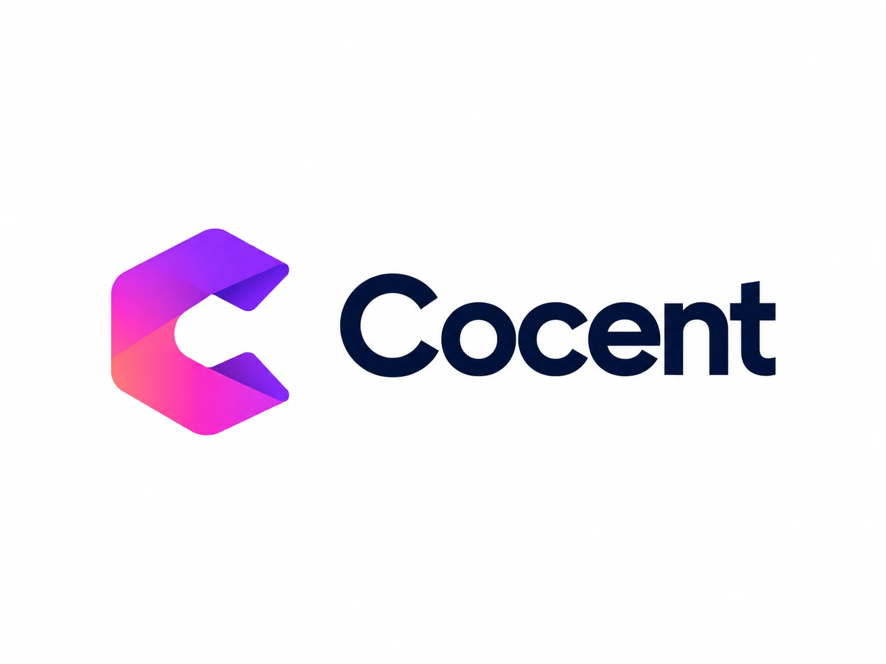
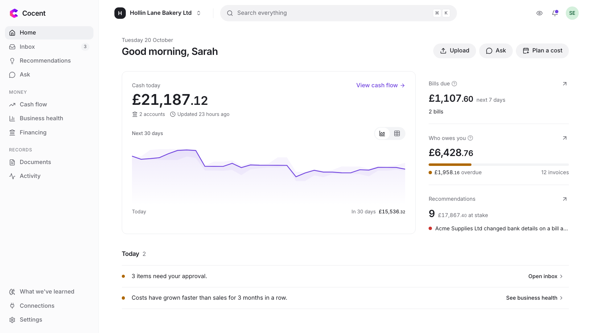

<strong>Every cent, with your consent.</strong>

# Cocent

Cocent is an AI finance assistant for small-business owners who don't have a finance team. It reads their bills, keeps an eye on their cash, warns them before money runs short and catches fake invoices. It never acts without a person's say-so.

> **Competition entry only.** Cocent is our entry to the 2026 Fintechathon International Track, Topic E: SME Finance Copilot. It is a prototype that runs on test (sandbox) services with made-up data. It is not a financial service, gives no financial advice, and is not for commercial use. It is licensed under [PolyForm Strict 1.0.0](LICENSE): you may use it for non-commercial purposes such as evaluating our entry, but not change it, share copies or use it commercially without our written permission.

**[Watch the 5-minute demo](docs/video/cocent-demo.mp4)**

## Who it's for

Meet Sarah. She runs a six-person bakery in Leeds that supplies local cafés, and does the books in the evenings. Her bills arrive by email, customers pay by card or bank transfer, and her money sits in one business bank account. She can't easily answer three questions:

- **Where does my cash stand, and will it last?**
- **Who still owes me?**
- **Is this bill real?**

She isn't alone. 82% of UK small and medium businesses have had cash-flow problems, on average 7.4 times a year ([Novuna, Dec 2025](https://www.cicm.com/resource/one-in-three-sme-leaders-do-not-fully-understand-cash-flow-despite-82-facing-cash-flow-problems.html)). Owners spend about 11 hours a week on admin and finance ([American Express SME Barometer, Jul 2026](https://retailtimes.co.uk/amex-sme-barometer-small-business-owners-spend-nearly-twice-the-time-on-admin-than-growing-their-business/)). And £41.3m was lost in the UK in 2025 to invoice and mandate scams, where a fraudster poses as a supplier and asks for payment to new bank details ([UK Finance Annual Fraud Report 2026](https://www.ukfinance.org.uk/policy-and-guidance/reports/annual-fraud-report-2026)).

## What Cocent does

1. **Bills in, no typing.** Cocent reads bills from the inbox they already arrive in, hides personal details before the AI sees anything, checks every figure, and adds the bill to the books with the original attached after one approval.
2. **Cash ahead.** One picture of the bank, card payments and books; a 90-day forecast; a warning weeks before cash runs short; and financing options compared by their real cost.
3. **Safe by design.** A fake "new bank details" email is flagged, and changing a supplier's bank details needs two people. Every action has a fixed approval level, and every step goes into a log that shows any tampering.

Also: recommendations (price rises, slow payers, creeping costs), payment reminders in three steps, a business health page, and questions answered in plain English from the business's own numbers.

## Before and after

| Task | Before | With Cocent (measured in our demo run) |
|---|---|---|
| A bill reaches the books | Typed in by hand, PDF filed separately | Read and checked in 6 to 11 seconds; one approval adds it with the original attached |
| Matching the bank to invoices and bills | Line by line, by hand | 146 bank payments linked to what they paid in the first read |
| Next month's cash | A spreadsheet, if anyone makes one | A 90-day forecast that updates itself, with best and worst case |
| "We've changed our bank details" | Often paid without a second look | Flagged on the bill; two people must approve the change |

## Find your way around

| I want to… | Open |
|---|---|
| Run Cocent on my computer | [Run Cocent yourself](docs/setup/README.md) |
| Set up the AI gateway, Stripe, Plaid, QuickBooks or the email inbox | [AI gateway](docs/setup/ai-gateway.md) · [Stripe](docs/setup/stripe.md) · [Plaid](docs/setup/plaid.md) · [QuickBooks](docs/setup/quickbooks.md) · [Email inbox](docs/setup/email.md) |
| Fill it with demo data | [Demo data](docs/setup/demo-data.md) |
| Know what it does | [Project scope](docs/SCOPE.md) |
| See how it fits together | [Architecture](docs/ARCHITECTURE.md) |
| See how it reads, matches, forecasts and recommends | [Core algorithms](docs/ALGORITHMS.md) |
| See how it keeps data safe | [Security design](docs/SECURITY.md) |
| See our honest security check and known risks | [Security self-assessment](docs/SELF-ASSESSMENT.md) |
| See the tests and their results | [Testing](docs/TESTING.md) |
| See proof it ran against the sandboxes | [Execution evidence](docs/EVIDENCE.md) |
| See what we built on, and the licences | [Third-party services and attribution](docs/THIRD-PARTY.md) |

## Competition checklist

| The competition asks for | Where it is |
|---|---|
| Technical documentation: architecture, core algorithms, security design | [Architecture](docs/ARCHITECTURE.md), [Core algorithms](docs/ALGORITHMS.md), [Security](docs/SECURITY.md) |
| Demo video, under 5 minutes | [cocent-demo.mp4](docs/video/cocent-demo.mp4) (4:44) |
| Source code with README, deployment instructions and test cases | This repository, [Run Cocent yourself](docs/setup/README.md), [Testing](docs/TESTING.md) and [`tests/`](tests/README.md) |
| Security self-assessment: approval levels and known risks | [Security self-assessment](docs/SELF-ASSESSMENT.md) |
| Execution evidence: sandbox logs and demo video | [Execution evidence](docs/EVIDENCE.md) |

## What's in this repository

| Folder | What it holds |
|---|---|
| `backend/` | The server: reading documents, connectors, forecasts, recommendations, approvals and the AI workflows |
| `frontend/` | The app people use in the browser |
| `tests/` | Every test, kept apart from the app code |
| `docs/` | Documentation, diagrams, the demo video and evidence |
| `infra/` | Database setup for the local services |

## The name

- **Co**: a copilot. It works alongside the owner and doesn't replace them.
- **Cent**: every cent counts, in any currency.
- **Sounds like "consent"**: nothing happens without a person's say-so.

## Licence

Copyright © 2026 the Cocent team. Cocent is licensed under the [PolyForm Strict License 1.0.0](LICENSE), a standard source-available licence. You may download, run and evaluate it for non-commercial purposes. You may not change it, share copies of it or use it commercially without our written permission. The licence grants no right to our name or logo. Third-party components keep their own licences: see [Third-party services and attribution](docs/THIRD-PARTY.md).
