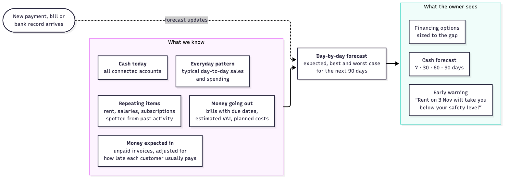
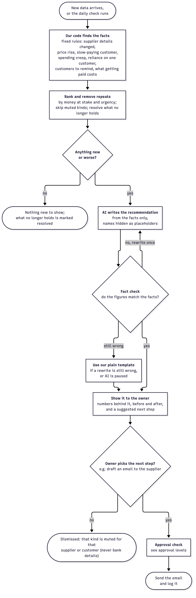

# Core Algorithms

This document explains how we turn raw documents and transactions into forecasts, warnings, analysis and recommendations. Wherever possible we use simple, predictable rules. AI is used only where reading or explaining language is needed, and every AI answer is checked by our own code.

## 1. Hiding personal details

Before any text reaches the AI, we find and replace sensitive details.

| Detail | How we find it |
|---|---|
| Card numbers | Number pattern plus the card checksum (Luhn) |
| Bank account numbers (IBAN, sort code, routing number) | Number pattern plus the bank checksum where one exists |
| Tax and company IDs | Country-specific patterns |
| Emails, phone numbers, web links | Patterns |
| People's names | Microsoft Presidio's language model |
| Street addresses and postcodes | Our own patterns |

Each value becomes a placeholder such as `[BANK_ACCOUNT_1]`. The real value goes into a separate encrypted store, so we can put it back after the AI has finished. A final scan checks the outgoing text again, and if anything is left, nothing is sent.

## 2. Reading a document

1. **Read the text** from the PDF, or with OCR for photos and scans, noting where each word sits on the page.
2. **Hide personal details** (section 1).
3. **AI fills in a fixed form:** document type, supplier or customer, dates, currency, line items, tax, total, and invoice or reference number.
4. **Our code checks the form:**
   - every required field is filled in;
   - line items add up to the subtotal, and subtotal plus tax equals the total;
   - dates make sense (for example, the due date is not before the issue date);
   - every amount, date and reference number actually appears in the document text.
5. **If a check fails:** the AI tries once more and is told exactly what was wrong. If it fails again, a second AI model reads the document independently. If the two agree on the key fields (total, currency, due date, supplier) and the second reading passes every check, we accept the result. If not, a person decides. A document that needed more than one attempt is never recorded automatically.

## 3. Matching payments

We link every invoice, bill and payment to its partner, such as an invoice to the customer payment that settled it, or a payout to the bank deposit it became.

**Step 1: exact rules.** These come first and settle most cases:
- the payment carries the invoice number, and the amount is right (allowing small fees);
- the payment platform's own invoice ID links the payment to the invoice;
- the payout ID from the payment platform matches the bank deposit;
- the amount still owed, the other party and the due date (or issue date) all match exactly.

**Step 2: scoring.** For anything left over, each possible pair earns points:

| Signal | Points |
|---|---|
| Same amount (allowing small fees) | 40 |
| Reference or invoice number found | 30 |
| Dates close together | 20 within 3 days (7 days on or after the invoice date); 10 within 14 days |
| Similar name of the other party | 10 |

- **85 points or more:** a confident match. It is accepted automatically if the approval rules allow it.
- **60 to 84 points:** a suggestion that a person confirms.
- **Below 60:** left unmatched.

One payment can also settle 2 to 4 invoices or bills from the same party. Such a combination is always a suggestion for a person to confirm.

**Never suggested:** a payment that names a different invoice or bill of ours, or clearly comes from a different customer or supplier; and two items from the same accounting or payment software, which already records what each payment settled. A pair a person turned down is not suggested again, and a suggestion that no longer fits (the invoice was paid another way, the payment was cancelled) is withdrawn.

**Same money, seen twice:** a bank payment for an invoice or bill the accounting software already shows as paid is linked to it without changing either. We find it by the invoice number, or by the same party and amount within 3 days.

## 4. Cash forecast

We build the forecast day by day for the next 90 days from these ingredients:

1. **Cash today** across all connected accounts.
2. **Money expected in:** each unpaid invoice is placed on the day the customer is likely to pay, based on how late that customer has paid before.
3. **Money going out:** bills on their due dates.
4. **Repeating items:** rent, salaries and subscriptions, spotted because bank lines with the same description repeat at a regular interval; we use their usual amount, or the latest if it is rising. Regular customers and suppliers are spotted from how often they are invoiced or billed, which is steadier than when they pay; their next invoices and bills are placed after their usual payment delay.
5. **VAT:** for a UK business, when the bank doesn't yet show a regular VAT payment, we estimate the next one from the VAT on that quarter's invoices, bills and card sales.
6. **Everyday pattern:** the typical net in or out for each day of the week, covering everything not listed above.
7. **Planned costs** the owner adds, which never change real records.

Bills that are already overdue are assumed to be paid now. Invoices more than 60 days overdue are only counted in the best case. Money already sitting in the payment platform arrives with the next payout, so it isn't counted twice. Accounts and items in another currency are left out and listed, because we hold no exchange rates.

We show an **expected** line, plus a **best** and **worst** case built from how much customer payment dates and everyday activity have varied in the past. The forecast is recalculated whenever a new payment, bill or bank record arrives.

## 5. Early warnings

1. Walk through the forecast day by day.
2. Find the first day the expected balance drops below the owner's **safety level** (by default, two weeks of usual spending).
3. Identify the bills and payments that cause the drop.
4. Raise a warning that names them and says how many days are left, for example "Rent on 3 November will take you below your safety level".

Warnings are graded **watch** (worst case only), **warning** (expected case) and **urgent** (within 7 days).

## 6. Business health

All figures come from our single record of money in and out. Each item is given a category (such as rent, stock or software): from the accounting software, from what the AI read on the bill, or from the supplier's usual category. Bank lines use the bank's own category or keywords.

| Measure | How we calculate it |
|---|---|
| Profit and loss | Sales minus costs for each month; margin is profit divided by sales |
| Where the money goes | Spending grouped by category, plus the ten largest suppliers |
| Who owes you | Unpaid invoices grouped as not yet due, 1–30, 31–60, 61–90 and over 90 days overdue |
| Days to get paid | Average days from invoice date to payment over the last 90 days, weighted by amount |
| Cash runway | Cash today divided by the average monthly net outflow over the last 3 months (shown only when the business is spending more than it earns) |

**Health checks** are simple rules that raise a plain-words note:
- costs have grown faster than sales for 3 months in a row;
- margin has fallen by more than 5 points compared with the previous quarter;
- more than 20% of unpaid invoices are over 30 days overdue;
- runway is under 3 months.

## 7. Explaining why cash changed

1. Compare two periods, for example this month against last month.
2. Split the change into groups: customer payments (noting how much that fell due is still unpaid, which shows late payment), card sales, supplier costs, salaries, rent, tax, financing, one-off items and other. The groups add up exactly to the change.
3. Rank the groups by how much each moved cash, and find the largest single items within each.
4. The AI writes a short explanation **from these numbers only**.
5. Our code then checks that every figure in the explanation matches the calculation. If it doesn't after one rewrite, we show our own plain sentence instead.

## 8. What-if: "Can I afford this?"

1. The owner, or the chat assistant, describes a planned cost: amount, date, and whether it is one-off or repeating.
2. We add it to a copy of the forecast. Real records are not changed.
3. We report the new lowest cash point and its date. We also work out whether it falls below the safety level and how much is missing.
4. In the assistant, that missing amount can be passed to the financing options (section 10).

## 9. Recommendations

An AI agent reviews the business's own records whenever new data arrives and once a day.

1. **Our code finds the facts.** Fixed rules (below) look for patterns and record the numbers and documents behind each one.
2. **Rank and remove repeats.** Findings are ranked by money at stake and urgency. A finding someone dismissed is not shown again unless it gets worse: more urgent, or 20% more at stake or in its own measure (the price rise, days late or share of sales). One that was acted on comes back if the rule still finds it. One that no longer holds, such as a fraudulent bill that was turned down, is marked resolved.
3. **The AI writes the recommendation** from the finding only. Names appear as placeholders such as `[SUPPLIER_1]`, and our code puts the real names back afterwards.
4. **Fact check.** Every figure in the text must match the finding: money must be money from the finding and a percentage a percentage from it (rounding to the pound is allowed), and every placeholder must be one we sent. The AI gets one rewrite, told exactly what was wrong; after that, or while AI is paused, we show our own plain wording.
5. **Show it with a next step.** Clicking the next step drafts an email (also worded by the AI and fact-checked), which waits in the inbox for approval. It always goes to the address on record; when details have changed, to the address on record before the change.

| Recommendation | When it is raised | Suggested next step |
|---|---|---|
| Supplier details changed | The address, email, phone or bank details on a bill from the last 90 days (approved or still waiting) differ from the supplier's record. We keep every past version, so we can show before and after. The same address read slightly differently is not a change. All the changes on one bill are one finding; bills sharing the same new bank details are one finding. | Confirm with the supplier using the contact details already on record. Bank-detail changes also raise a fraud warning (section 11). |
| Supplier price rise | The supplier's latest two bills (the latest, for a monthly supplier) are 10% or more above its usual level (the median of the 3 months before), or a price per unit on a bill is 10% or more above that line's usual price. Where past bills show only line totals, the usual unit price is the largest price that most past totals are whole multiples of (8 bags at £45.00 is £360.00). A charge that rises step by step every month is spending creep instead. | Draft an email asking about the increase, or compare with other suppliers |
| Slow-paying customer | Across at least 3 invoices, a customer pays 7 or more days after the due date on average, or their invoices of the last 60 days are paid 7 or more days late and 3 or more days later than before | Ask for a deposit or payment upfront, shorten payment terms, offer an early-payment discount, or send a reminder before the due date (overdue invoices are chased by the reminders in section 14) |
| Spending creep | A spending category rose in each of the last 3 full months, by 10% or more and at least £10 a month in all, or a new supplier has billed about once a month for the last 100 days | Review the cost |
| Reliance on one customer | One customer was invoiced more than 30% of sales over the last 90 days (at least 2 customers) | For information |
| Customer to remind | An invoice is overdue and the next reminder step is due (section 14) | Approve the drafted reminder |
| What getting paid costs | A customer's payments arrive short or slowly compared with card payments (section 14) | Add a card payment link to reminders |

The owner can dismiss a recommendation; dismissing it mutes that kind of recommendation for that supplier or customer. Changed bank details are never muted: a different change is always shown.

## 10. Financing options

### Business profile

| Filled in automatically | Added by the owner |
|---|---|
| Months trading (from the first transaction) | Country and industry |
| Average monthly sales over 6 months, and their trend | Business type (for example sole trader or company) |
| Share of sales paid by card | Assets owned, such as property or vehicles |
| Unpaid invoices and days to get paid | Self-declared credit band |
| Existing loan repayments (bank payments to lenders over 90 days, as a monthly average) | What the money is for |

The owner can correct any automatic value. We keep the original next to the correction and note who changed it.

### Financing catalog

A table of 11 products loaded from a data file. Each product has a type, provider, amount range, term range, rate range, fees and eligibility rules, such as minimum months trading, minimum monthly sales, needs card sales, needs unpaid invoices, and countries served. In our demo the providers and rates are sample data.

### Matching steps

1. **Work out the need.**
   - From the forecast: the amount is the safety level minus the lowest expected balance, plus 5% for the cost of borrowing, rounded up to £100. The length runs from the first day below the safety level until cash recovers, so repayments start after that.
   - From a what-if in the assistant: the amount missing at the lowest point.
   - From the owner: an amount and purpose typed in, such as "£20,000 for a van".
2. **Check eligibility.** Each product's rules are checked against the profile. Products the business doesn't qualify for are removed. Near misses are shown with the reason, for example "available after 3 more months of trading".
3. **Work out the cost** for the amount and length needed, using the middle of the rate range and showing the range too:

   | Product | How cost is worked out |
   |---|---|
   | Ask a supplier for longer terms | Free; up to the bills currently unpaid |
   | Discount early payment from customers | The discount given (2% in the sample catalog); up to the unpaid invoices |
   | Loan (short-term, bank, start-up, vehicle and equipment) | Standard monthly repayment formula, plus fees, which come off the money received |
   | Line of credit or overdraft | Interest only on the amount and days used, plus fees; the amount is repaid at the end |
   | Invoice financing | Monthly fee times the invoices used, until customers usually pay; up to 85% of unpaid invoices paid upfront |
   | Merchant cash advance | Fixed multiple of the amount, repaid as 12% of card sales; we estimate how long that takes and show the yearly cost, which is usually high |

4. **Check the effect on the forecast.** The money in and the repayments are added to a copy of the forecast, and we report whether cash stays above the safety level.
5. **Rank.** Options the business qualifies for first: free options, then options that keep cash above the safety level, each by total cost.
6. **Readiness checklist.** What a lender usually looks at: months of trading, sales trend, share of overdue invoices, existing repayments compared with monthly cash coming in, how up to date the books are, and whether the profile is complete. Each item says what would improve it. It is not a credit score.
7. **Summary.** The AI writes a short summary from these numbers, which is fact-checked.

The same steps run in two ways: **from the assistant**, and **on the Financing page**, which a shortfall warning on the forecast links to, where the owner browses the catalog and moves amount and term sliders to recalculate cost and forecast effect.

### Lender pack

On request we generate a PDF with the business profile, profit and loss for the last 12 months, unpaid invoices, the cash forecast and the readiness checklist. Every figure comes from our records. Sharing it with a lender is an outside action and needs approval. We never apply for financing on the owner's behalf.

We present financing options as information, not personal financial advice.

## 11. Fraud warnings

| Warning | Trigger |
|---|---|
| Changed bank details | A supplier's bank details differ from the ones on record |
| Duplicate invoice | Same file fingerprint, or same supplier, invoice number and amount |
| Look-alike sender | The sender's or bill's email domain is one or two letters away from a known supplier's |
| Failed sender checks | The email fails the standard sender checks (SPF, DKIM, DMARC) |
| Unusual amount | Far above that supplier's usual range |
| Pressure tactics | A new supplier whose message uses urgent payment language |

Any warning blocks automatic processing and sends the item to a person.

## 12. Answering questions about the business

The chat assistant answers using read-only tools that run the calculations above. It never reads raw documents: document search uses the text the AI was already shown when we read each document, cleaned again as described below.

| Tool | Answers questions such as |
|---|---|
| Cash position and forecast | "What does my cash flow look like next month?" |
| Profit and loss, spending | "How is the business doing this quarter?", "What do I spend most on?" |
| Who owes you, customer payment habits | "Who owes me the most, and who pays late?" |
| Supplier history | "Has Acme put its prices up?" |
| Why cash changed | "Why is my cash lower than last month?" |
| What-if | "Can I afford a new van next month?" |
| Financing options | "How could I cover a shortfall in December?" |
| Recommendations | "Is there anything I should look at?" |
| Totals from the records | "How much did we spend on each category this year?", "How many invoices did we send in March?" |
| Search the documents | "Which supplier mentions late payment fees?" |

### Totals from the records

For questions the other tools don't cover, the AI fills in a small form and our code builds the query. The AI never writes SQL.

| Choice | Allowed values |
|---|---|
| What to count | sales invoices, bills, money in at the bank, money out at the bank, payment platform fees |
| Filters | one supplier or customer (by placeholder), one category from the list we give it, a date range |
| Date range | up to 24 months; with no dates, the last 12 months |
| Group by | month, category, supplier or customer, or nothing |
| Measure | total, count or average |

The query uses only these columns, in the same read-only transaction that sees one business, and leaves out void records and other currencies. It returns at most 24 rows. Money is written the same way as everywhere else, and suppliers and customers appear only as placeholders. The list of categories we give the AI holds plain words only: any category that looks like a name or a personal detail is left out. If the AI names a supplier or customer we don't know, we count nothing rather than give a total for everyone.

### Searching the documents

We keep a full-text index (Postgres `tsvector` with a GIN index) over each document's text as the AI saw it when we read it, so it already has placeholders in place of personal details. The search words come from the AI, which only ever saw the question with details hidden. Searching for a real name or number therefore finds nothing. We take the best three documents, and up to two short windows around the words that matched, about 300 characters in all.

Each passage is cleaned again before it goes anywhere:
1. **Its own placeholders become neutral tags.** A document numbers its hidden details from 1, and so does the chat, so `[PERSON_1]` in a document could be confused with `[PERSON_1]` in the question. They become tags such as `[hidden person]` or `[hidden bank account]`, which are never put back.
2. **Details still found are hidden.** We run the detectors from section 1 over the whole text: patterns such as emails and bank details first, then supplier and customer names become the chat's placeholders, then people's names. This catches anything missed when the document was read.
3. **The windows are cut afterwards**, on whole words, and never split a placeholder or a tag. The detectors run once more over each window.
4. **The usual steps follow.** Like every tool result, the passages are hidden again with the chat's numbering, and the final scan checks the exact text sent.

Earlier turns of a conversation get the same treatment as step 1 when they go back to the AI: supplier and customer placeholders keep their numbers, which are the same in every turn, and any other placeholder becomes a neutral tag.

The app shows the same cleaned passage under the answer, linked to its document. Only people whose role lets them review documents can search them.

### What we measure

For each person we count the questions answered from our records, and how many of those passed the fact check on the first try. The Ask page shows both.

### How it stays safe and correct

- **Names hidden.** Supplier and customer names in the question (including a short form such as "Acme") become placeholders, other personal details are hidden as in section 1, and tool results use the same placeholders.
- **Fixed, read-only tools.** The AI can only pick tools from this list, at most three per question. They run in a database transaction that refuses any change and sees one business. Tools the person's role doesn't allow (financing, for bookkeepers) are left out and the answer says so. Questions not about the business are declined.
- **Fact check.** Every figure in the answer must come from the tool results or the question, as in section 9. After one rewrite we show the figures in plain form instead.
- **Charts and tables from our code.** The chart or table under an answer and its sources come from the tool results, never from the AI.
- **Actions only on a click.** The AI may suggest a payment reminder or a supplier email. It becomes a draft only when the person clicks it, and then waits for approval.
- **Private history.** Each conversation belongs to one person; the AI sees only that conversation's earlier turns, as placeholders.

## 13. Learning from decisions

Cocent learns from two things people already do: correcting what was read from a document, and acting on or turning down a recommendation. What it learns stays in our database. Nothing extra is sent to the AI, and learning never approves anything by itself.

### Remembering corrections

We keep every correction beside the AI's original answer, even when a field is corrected more than once, together with the supplier or customer it belongs to.

| What we learn, per supplier or customer | Learned from |
|---|---|
| What it's for (category) | Corrections to the category |
| Type (bill, receipt, credit note and so on) | Corrections to the type |
| Currency | Corrections to the currency |
| Payment terms (days from issue to due date) | Corrections to the issue or due date |
| Supplier name (what the AI reads, mapped to the real supplier) | Corrections to the name |

- **When a value counts as learned.** After the same correction on 2 approved documents from one supplier, with none since that disagree. A later correction to something else, or a later approved document that ended up different, stops it. Corrections on documents still waiting or turned down don't count.
- **Using it.** When a new document is read, we fill in the learned values before the supplier is looked up. Each one shows "Filled from your past corrections" beside the field, with Undo, which puts back what the AI read and counts as a disagreement.
- **Still checked.** The usual checks and approvals still apply. Only a learned category may be recorded automatically; a learned type, currency, due date or name always waits for a person.
- **Never learned.** Bank details, contact details and amounts. These can't be corrected through the review screen, and bank details are never used to decide anything automatically.

### Ranking recommendations that learns

Each kind of recommendation keeps a count of how often it was acted on (the next step was clicked, or its drafted email approved) and turned down (dismissed, or its email rejected). A later decision on the same recommendation replaces the earlier one, so nothing counts twice.

We order recommendations with Thompson sampling, a standard way to balance showing what has worked with still trying the rest:

1. For each kind, we draw a number from a Beta(1 + acted on, 1 + turned down) distribution. A kind usually acted on draws close to 1, one usually dismissed close to 0, and one with few decisions anywhere in between, so it still gets a chance. A kind with no decisions yet uses 0.5, so the order stays by money until people start deciding.
2. Each recommendation's score is that draw times the money at stake.
3. We reorder only within the same severity. A minor item never jumps above a more serious one.
4. The draw is seeded by the business, the day and the kind, so the order stays the same all day and differs between businesses.

Safety limits:
- **Urgent items and changed bank details are never moved down.** They come first in their group in their usual order, whatever was learned, and are never folded.
- **Folded, never hidden.** A kind acted on less than 20% of the time after 5 or more decisions, at severity "watch" or below, is shown folded under "Less useful to you".

### Seeing and resetting it

The "What we've learned" page explains in plain words what was learned for each supplier and each kind of recommendation, with the counts behind it. A business owner can reset one learned value, everything for one supplier, one kind's ranking, or everything. Corrections are kept as history but no longer learned from, and every reset is written to the activity log.

### What it measures

| Number | Meaning |
|---|---|
| Values filled in | Fields we filled in from past corrections, and how many a person undid |
| Time saved | Values filled in and kept on approved documents, times 30 seconds each. We assume that is how long finding a value on the document and typing it in takes. |
| Top recommendation acted on | How often the recommendation first in the list was acted on rather than turned down |
| Recommendations acted on | The same for every recommendation |

## 14. Getting paid faster and for less

We look at how each customer pays, spot payments that arrive short or slowly, and chase overdue invoices in three steps. Fixed rules find everything below. The AI only words the recommendations and the reminder emails, from the facts, with names as placeholders, and is fact-checked as in section 9.

### How we tell how a payment was made

| Way of paying | How we recognise it |
|---|---|
| Card | A card payment through the payment platform, which also tells us the card's country, or a payout of card sales from the platform |
| International transfer | A bank payment in a currency other than the account's, or whose text says SWIFT, INTL, international, FX, foreign, SEPA, IBAN, BIC or TT |
| Cash | A bank line that says cash or counter credit |
| Bank transfer | Any other bank payment: Faster Payments, BACS, standing orders |
| Not known | Nothing to go on |

The bank's own payment channel helps too: a payment made "in store" is a card payment. A payment-platform payment by bank debit counts as a bank transfer. Words are matched whole, so "fx" inside a company name doesn't count.

### Payments that arrive short, and bank charges

- When matching (section 3) settles an invoice with a payment a little below it, we record how much arrived short. "A little" is the usual fee allowance of 3% + 50p. For an international transfer we also allow up to £30, but never more than 10% of the invoice, because the banks on the way usually take a fixed charge rather than a percentage. For example, a £400 invoice paid by international transfer with £18.60 taken on the way is still matched.
- What is left on the invoice is not money the customer owes. We never chase it in a reminder, and we leave it out of who owes you, the cash forecast and the lender pack. Who owes you shows it separately, as short paid.
- When we work out how long customers take to pay (slow payers, payment habits in the forecast, days to get paid), such an invoice counts as paid on the day its payment arrived.
- Recording a bank charge closes it. A finance manager or business owner approves it, and as a small change it can be undone. We add a bank charge for what is left, dated the day the payment arrived, and the invoice is paid from that day.

### What a payment costs

For each customer, over the last 180 days, we compare each way of paying: how many payments, the total that arrived short, the average days from invoice to payment, and what the same payments would have cost by card.

- **The card fee** is the business's own: its card fees divided by its card payments over the same 180 days, once it has at least 3 card payments. Until then we use a typical rate: 1.5% + 20p for a UK card, and 3.25% + 20p for a customer who pays from abroad. These rates are assumptions, and we say so wherever we use them.
- **When we raise it:** payments arrived £10 or more short over at least 2 payments, or the customer's way of paying takes 5 or more days longer than card. For card we use the customer's own card payments, or else the business's once it has at least 3.
- **The saving** is what arrived short minus what card would have cost for all of that customer's payments made that way, so it is never flattered.
- **Next steps:** record what is left as bank charges, and send a card payment link with the next reminder.

### Reminders in three steps

| Step | Tone | When it is due | Who approves |
|---|---|---|---|
| 1 | Friendly | The day after an invoice falls overdue | Anyone who can send reminders |
| 2 | Firm | 7 days after reminder 1 | Anyone who can send reminders |
| 3 | Final notice | 14 days after reminder 2 | A business owner only |

- One reminder per customer at a time, covering every overdue invoice that is due the same step. After the final notice we stop; the slow-payer recommendation and business health keep showing the debt.
- We never chase what is left after a payment arrived short, or an invoice whose likely payment is waiting for a person to confirm the match.
- The AI words each step's email from the facts and is fact-checked, with our own template as the fallback, and the email waits for approval. When it is sent, we record the step for each invoice it covered. A step already sent for an invoice is never sent again.
- Only the reminders draft chasing emails, so a customer is never chased from two places.

### Payment link

- We make a card payment link only while an approved reminder is being sent, never for a draft. The approver is told beforehand whether one will be added.
- It needs a separate restricted test key (starting `rk_test_`) from the payment platform; we set it up with write access to products, prices and payment links only. Any other key, such as a full-access key or a live one, is ignored: the reminder then goes without a link, and the page says why.
- Each invoice gets one link for what is still owed, reused by later reminders while the amount stays the same. Every request carries an idempotency key, so a retry returns the same link rather than a second one.
- An invoice raised on the payment platform uses the platform's own page for paying it.
- Only an address on the platform's own payment pages goes into an email. If making the link fails, nothing is sent and the approval is not used up.
- Without a key, the reminder goes without a link and the reminder card says how to add one.

### The numbers we show

Over the last 180 days:
- the money lost to payments that arrived short, and how much of it is still to record as bank charges;
- what could be saved, after card fees, if the customers whose payments arrive short paid by card;
- how many days sooner card payments arrive than bank transfers, once there are at least 3 card payments and 3 bank transfers;
- for each invoice paid, the reminder step it had reached when it was paid.

## 15. Search

The search box at the top of every page finds customers and suppliers by name, invoices and bills by reference or amount, documents by filename or supplier, open recommendations by title, and approvals waiting for a person by their summary.

- **What counts as a match.** We look for the typed text anywhere in those fields, ignoring case. `%` and `_` are searched for as themselves, not as wildcards. Text that looks like money, such as `300`, `£300`, `300.00` or `1,800.00`, also finds invoices and bills of exactly that amount. A small typo in a supplier or customer name still finds them, using the same kind of name similarity we use when matching (section 3). Voided invoices and bills are left out. Fewer than 2 characters finds nothing; more than 100 is refused.
- **Best first.** An exact match comes first, then text that starts with the search, then a word inside it that starts with it, then a match anywhere, then near-matches by name. At each of those levels, results are grouped by kind: customers, suppliers, invoices, bills, documents, recommendations, approvals. We show at most 20, and at most 8 of one kind, so one kind cannot crowd out the rest.
- **Where a result leads.** Every result opens an existing page, by id only:

| Result | Opens |
|---|---|
| Document | Its review view |
| Invoice or bill read from a document | That document |
| Unpaid bill from the books | The cash forecast, which shows unpaid bills |
| Unpaid invoice from the books | Who owes you, on the business health page |
| Customer or supplier, or a paid invoice or bill | Their newest open recommendation, else their newest document, else who owes you (customers) or biggest suppliers |
| Recommendation | That recommendation |
| Approval | That approval in the inbox |

- **Private by design.** The search goes in the body of the request, not the address, so names never appear in addresses, browser history or access logs. We don't write what was searched for to the activity log or the server log. It runs in a read-only transaction that sees one business, and only for roles that can see all records (employees can't search). Each result is a short plain label, such as "Bill AS-1005 · Acme Supplies Ltd · £658.56", and the detectors from section 1 take out any bank details, emails or phone numbers, for example in a filename. Each person can search up to 60 times a minute.
