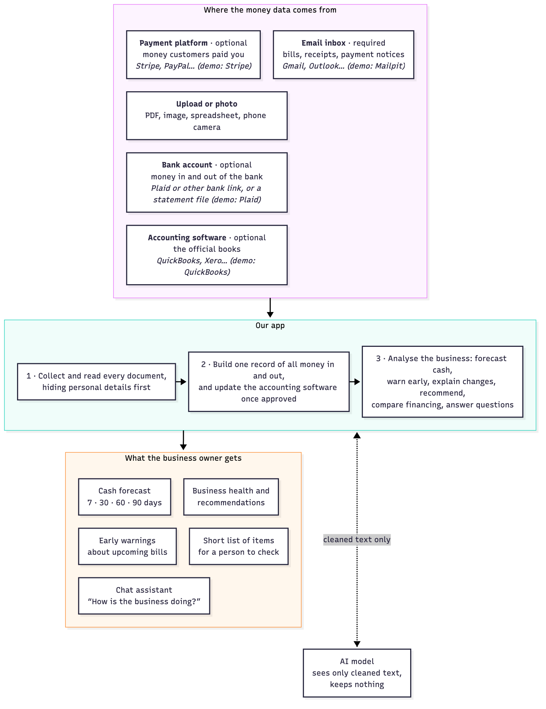
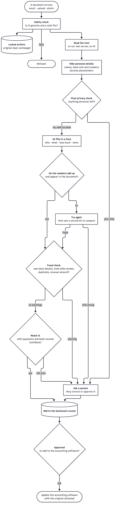
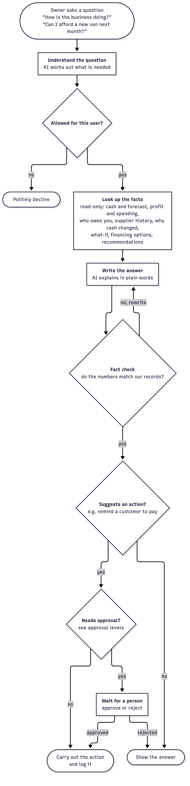

# Architecture

This document shows how our system fits together and how data moves through it. For what the app does, see [Project scope](SCOPE.md). For how each step works, see [Core algorithms](ALGORITHMS.md). For how we protect data, see [Security](SECURITY.md).

## The big picture

Money data flows in from the business's own tools. We clean and organise it, and the owner gets forecasts, warnings and answers. The AI only ever sees text with personal details removed, and it keeps nothing.

## Where the data comes from

Our app connects to **types** of tools, not to one brand. Each type has a connector that translates the tool's data into one common format, so supporting a new brand (for example PayPal or Xero) means adding one connector.

| Type | Needed? | What it tells us | Examples | In our demo |
|---|---|---|---|---|
| Email inbox | Required | Bills, receipts, payment notices | Gmail, Outlook, any IMAP mailbox | Mailpit test inbox |
| Payment platform | Optional | Money customers paid | Stripe, PayPal, Square | Stripe sandbox (UK, GBP) |
| Bank account | Optional | Money in and out of the bank | A live bank connection such as Plaid | Plaid sandbox (UK test bank), read on a schedule |
| Accounting software | Optional | The official books | QuickBooks, Xero | QuickBooks sandbox company (UK), read on a schedule |
| Upload or photo | Always available | Any PDF, image or spreadsheet; a phone photo, also sent from a phone by QR code | — | Built in |

**How email arrives.**
- **Demo:** Mailpit tells our app the moment each email arrives.
- **Production:** the business would forward bills to a dedicated inbox, read over IMAP (the standard way to read any mailbox). The demo inbox and a real one feed the same intake step.
- **Either way:** each email is processed only once, tracked by its unique message ID.

## How a document is processed

1. **Safety check.** We confirm the document really came from the connected source and check the file is safe to open. An unsafe file is refused.
2. **Locked archive.** We store the original exactly as received.
3. **Read the text.** Our own server reads the words from the PDF or photo. No AI is involved yet.
4. **Hide personal details.** Names, bank and card numbers and similar details are swapped for placeholders such as `[BANK_ACCOUNT_1]`.
5. **Final privacy check.** If anything personal is left, nothing is sent and a person takes over.
6. **AI fills in a form.** The AI records who, what, how much and when. It cannot take any action.
7. **Do the numbers add up?** Our code checks the totals and that every figure appears in the document.
8. **Try again.** We retry once, then a second AI gives an independent opinion. If the two disagree, a person decides.
9. **Fraud check.** We compare the bill with what we know about the supplier: changed bank details, a look-alike sender, failed sender checks, a duplicate invoice, an unusual amount or pressure to pay fast. Any warning sends it to a person.
10. **Match it.** We link the document to its payment or bank record. If we are not sure, a person decides.
11. **Record it.** A person approves it. A bill from a known supplier, with no warnings and under the business's approval limit, is recorded automatically and can be undone.
12. **Update the books.** Adding a bill to the accounting software, with the original attached, is a separate outside action that needs its own approval.

## How the assistant answers a question

The assistant answers questions about the business, such as how it is doing, what cash flow looks like, or who pays late. It looks up facts from our records, or searches document text with personal details hidden, and fact-checks its numbers before answering. It can suggest actions, but anything that matters waits for a person's approval (see [Security](SECURITY.md)).

## How recommendations are made

A recommendations agent reviews the business's records whenever new data arrives and once a day. Our code finds the facts, such as a supplier's changed address or a price rise. The AI only turns those facts into plain words, and its numbers are fact-checked. Any next step it suggests goes through approval (see [Core algorithms](ALGORITHMS.md), section 9).

## Checking our work

Anyone with permission can compare any extracted record with its original document.

- **Original kept safe:** every original document and email is kept unchanged in an encrypted archive. This is our master copy.
- **Copy in the books:** bills added to the accounting software carry the original document.
- **Side-by-side view:** the original sits next to what we extracted, with each value highlighted where it was found.
- **Corrections kept:** every human correction is saved alongside the AI's original answer.

## Technology

| Part | Technology |
|---|---|
| App (what users see) | TypeScript, React, shadcn/ui, Tailwind CSS, Lucide icons, Motion (animation) |
| Server | Python, FastAPI |
| AI workflow | LangGraph (the three workflows above) |
| AI model | Not tied to one model. All requests go through OpenRouter, limited to providers that don't keep or train on our data. A second, different model gives the independent opinion. |
| Reading documents | PyMuPDF, Tesseract OCR, openpyxl (spreadsheets), Microsoft Presidio with spaCy (personal-detail detection) |
| Phone photos | A QR code opens an upload page on the phone, which sends the photo straight to our server |
| Analysis and recommendations | RapidFuzz (comparing names, addresses and bill lines), phonenumbers (standard phone format) |
| Scheduled checks | APScheduler inside the API (bank reads every 15 minutes, accounting change feed every 10 minutes; daily recommendations run) |
| Charts | Recharts |
| Lender pack | ReportLab (PDF) |
| Security | argon2-cffi (password storage), pyotp (two-step sign-in), cryptography (encryption), dkimpy (email sender checks), python-magic (checking file types by content), pip-audit and npm audit (dependency scanning) |
| Storage | Postgres database (including the business profile), a sample financing catalog file, SeaweedFS (S3-compatible, through boto3) for the encrypted file archive |
| Live updates | Server-sent events (sse-starlette) |

## Key terms

- **Ledger:** our single record of all money in and out.
- **Reconciliation:** matching each payment to the invoice or bill it belongs to.
- **OCR:** reading text from a photo or scanned page.
- **IMAP:** the standard way to read emails from any mailbox.
- **Sandbox / test mode:** a safe practice version of a service with fake money and data.
- **Placeholder:** a stand-in such as `[BANK_ACCOUNT_1]` that hides a real value from the AI.
