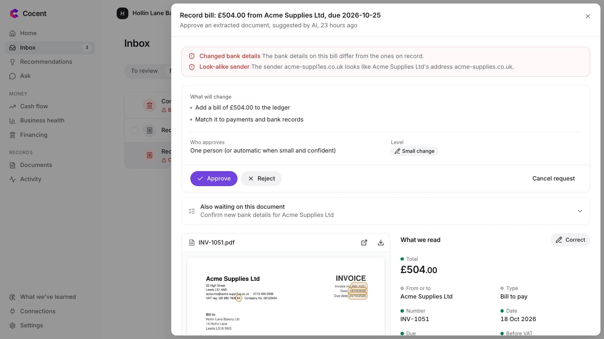
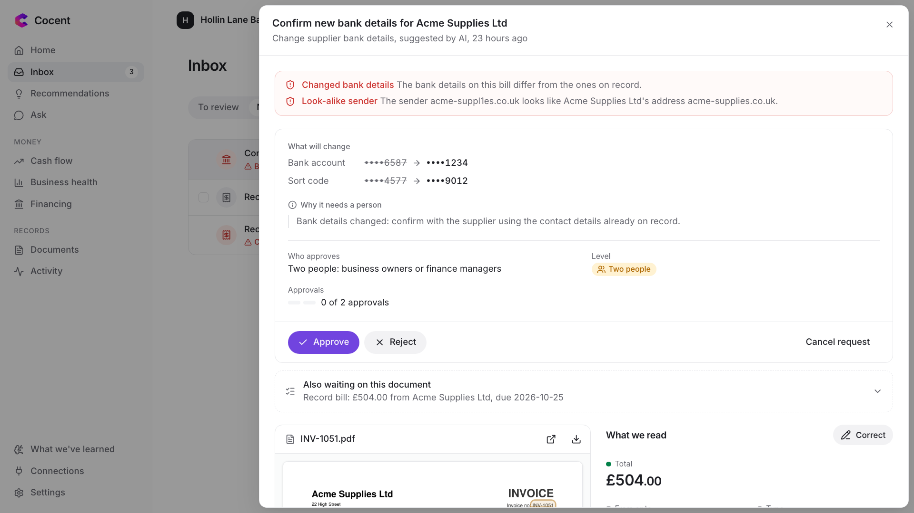
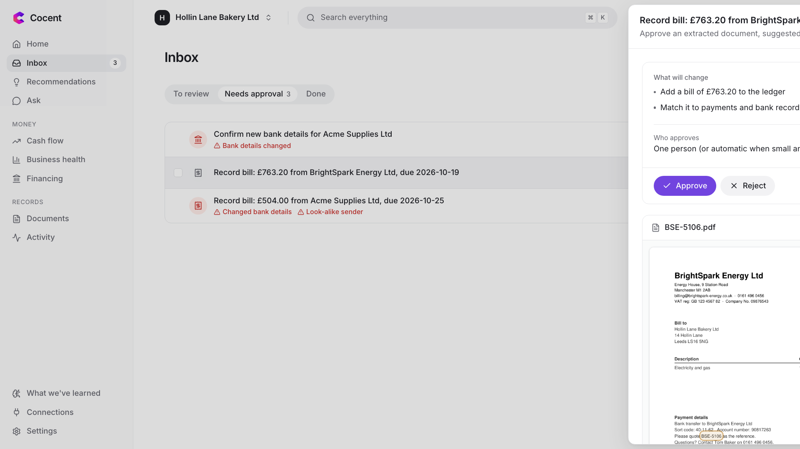

# Execution evidence

Proof that Cocent works end to end against real sandbox services: the demo video, the activity log from the same run, screenshots, and the results of our live checks. Every service ran in test mode with made-up data.

## Demo video

[cocent-demo.mp4](video/cocent-demo.mp4), 4 minutes 44 seconds. The demo bakery, Hollin Lane Bakery, follows one week:

1. A fake "new bank details" email is caught, and the change needs two people.
2. An energy bill from a sample supplier is read, with personal details hidden before the AI sees it.
3. Sarah approves the bill, then approves adding it to the accounting software with the original attached.
4. The forecast warns of a cash gap weeks ahead, and financing options are compared.
5. The activity log shows every step and confirms it hasn't been changed.

## The activity log from the demo run

[activity-log.csv](evidence/activity-log.csv) holds all 40 entries for the demo business, from setup on 18 October to the recorded demo run on 19 October 2026. We checked the whole chain in the database with our secret key: **intact, 40 of 40 entries**. The file is a readable export of those entries; the details column is a summary, so the chain itself can only be rechecked inside the app (Activity page).

What the log shows, in order:

| Entries | What happened | In the sandbox |
|---|---|---|
| 2–5 | The bank, payment platform and accounting software were read | Plaid: 1 account, 266 transactions. Stripe: 5 customers, 34 card payments with their fees, 1 refund, 1 dispute, 2 invoices. QuickBooks: 417 items. 146 bank payments linked to the invoices and bills they paid. |
| 6–15 | A first sign-in with two-step, and a setup check: an earlier Acme bill (£504.00) was uploaded, read and approved, and its accounting-software step was cancelled | Shows the cancel path: nothing was sent to QuickBooks |
| 16–17 | The fake Acme email arrived | Sender checks passed for the look-alike domain `acme-suppl1es.co.uk`, so only Cocent's own comparison could catch it |
| 18 | Personal details were hidden before the AI saw the bill | 11 details: a person, an email address, a phone number, a tax ID, a company number, 2 addresses, 2 postcodes, a sort code and a bank account |
| 19–21 | The AI filled in the form, which passed every check | The bank-detail change was proposed at **level 4 (two people)** |
| 22–26 | BrightSpark's energy bill arrived, details hidden, read in 6 seconds | Proposed at level 2 for one approval |
| 27–28 | Recommendations were worked out for the first time | 8 new, then 1 more after the energy bill |
| 29–32 | Sarah signed in with two-step on the day of the recording and opened the originals | — |
| 33–37 | Sarah approved the bill, then approved adding it to the accounting software | QuickBooks sandbox: bill 519 created for £763.20, with the original PDF attached |
| 38–40 | Recommendations refreshed, the bank was read again, and a planned cost was tried out | — |

## Screenshots

| | |
|---|---|
|  **Home:** cash today, the next 30 days and what needs attention |  **Fraud warning:** changed bank details and a look-alike sender, on the bill itself |
|  **Two-person approval** for the bank-detail change |  **Approval card:** exactly what will change, and who must approve |

## Live checks against the sandboxes

On 20 October 2026 we ran our live checks against the real Stripe and Plaid sandboxes (`tests/backend/contract`):

| Check | Result |
|---|---|
| Every Stripe object fits our shape (7 kinds) | Pass |
| Card payments carry their fee; the balance is in pounds | Pass |
| Our Stripe key cannot change anything | Pass |
| The Plaid test bank is a UK bank without an extra sign-in screen | Pass |
| The whole six-month story arrives from Plaid in our shapes | Pass |
| The Plaid balance matches the story | Pass |
| An expired bank login is reported as expired | Pass |

QuickBooks was checked live in the demo run above: bill 519 was added to the sandbox company by an approved action, with its PDF attached.

## Tests

All server, app and browser tests pass. See [Testing](TESTING.md) for the full results.
