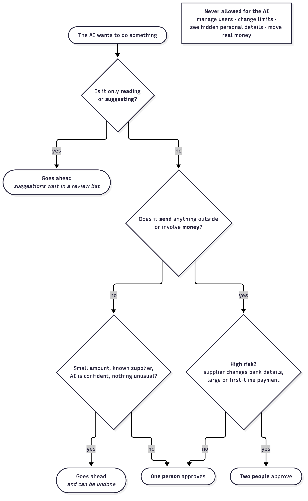

# Security

Our app handles a business's most sensitive information: bills, bank details, customers and cash. This document explains how we protect it, how our approval levels work, and the risks we know about.

## Our principles

1. **The AI never sees personal details.** It only gets text with those details replaced by placeholders.
2. **The AI suggests; people decide.** Anything involving money or the outside world needs a person's approval.
3. **Least access.** Every connection, user and AI step gets only the access it needs.
4. **Everything is recorded.** Every step is written to a permanent, tamper-evident log.

## Protecting data

- **Personal details** (names, bank and card numbers, tax IDs, contact details) are replaced before the AI step and kept in a separate encrypted store with its own database account.
- **Original documents** are stored unchanged in an encrypted archive. Each carries a digital fingerprint (SHA-256), so any change is detected.
- **Each business's data is walled off** from every other business at the database level.
- **Passwords and connection keys** are encrypted, stay on the server and are never shown to the AI.
- **Our own logs** never contain document text. They hold only placeholders and fingerprints.
- **All traffic is encrypted** in transit.

## Keeping the AI safe

- **What we send:** cleaned text only. We never send images, PDFs or raw emails.
- **Where we send it:** every AI request goes through OpenRouter with its privacy settings switched on, so it can only be served by providers that neither keep our data nor train on it. Models and providers that don't meet this are ruled out automatically. If no such provider is available, the request fails rather than going elsewhere.
- **The document-reading AI cannot act.** It can only fill in a fixed form, so hidden instructions planted in a document cannot make it do anything.
- **Every AI answer is checked** by our code: totals must add up and every figure must appear in the source (see [Core algorithms](ALGORITHMS.md)).
- **The chat assistant and the recommendations agent work from our records, never from raw documents.** They can only read that one business's records, see names and contact details only as placeholders, and any action they suggest goes through approval.
- **Document text is marked as data.** Our instructions tell the AI that document text is information to read, never instructions to follow.
- **Our instructions to the AI hold no secrets.** They contain no keys, passwords or rules that security depends on; every security rule is enforced in our code.
- **AI answers are treated as untrusted.** They must match a fixed format, are shown as plain text (never as web page code), and are never used to build database queries or web addresses.
- **Spending and usage limits.** A daily spending cap, a limit on requests per business, a cap on answer length and at most one retry stop runaway use.

### Second checks at the AI gateway

Every request also passes OpenRouter's guardrails before it reaches any AI provider. These are a second safety net behind our own checks:

| Check | What it does | If it triggers |
|---|---|---|
| Hidden instructions | Scans every message for known prompt-injection phrases, based on OWASP patterns | The request is blocked and the document goes to a person, marked "possible hidden instructions" |
| Bank and tax details | Looks for card numbers, IBANs, sort codes, account numbers, National Insurance and VAT numbers, email addresses and secret keys | The request is blocked. Because our own redaction should already have removed these, we log it as a near miss and send the item to a person. |
| Lower-risk details | Looks for phone numbers, postcodes and IP addresses | The detail is replaced with a label. If a label appears in an answer, we log it and send the item for review. |
| Allowed models and providers | Only our chosen models, and only providers that keep nothing | Any other request is refused |
| Spending cap | A daily budget for all AI use | Requests stop until the next day |

## Approval levels

| Level | Examples | Who decides |
|---|---|---|
| 0 · Read | Look at records, forecast, analyse, explain, warn | Automatic |
| 1 · Suggest | Draft a bill, suggest a match, raise a recommendation, draft a reminder | Automatic; waits in the review list |
| 2 · Small change | Accept a match, record a known monthly bill | Automatic only if small, confident, from a known supplier and with no warnings; otherwise one person. Can be undone. |
| 3 · Outside action | Update the accounting software, email a customer, schedule a payment, share a lender pack | One person |
| 4 · High risk | Supplier bank-detail change, large or first-time payment | Two different people |
| Never | Manage users, change limits, see hidden personal details, move real money | Not available to the AI |

### People and what they can do

Our roles are the essential jobs found in small-business finance, based on the user types common in accounting and bill-payment software. In a small business one person often does several of these jobs, so a user can hold more than one role.

| Role | Who this is | Can | Cannot |
|---|---|---|---|
| Business owner | The owner or a director. There may be more than one. | Everything: add users, set approval limits, connect tools, approve any action, edit the business profile, share a lender pack | — |
| Finance manager | A financial controller or office manager who runs day-to-day money, found in larger small businesses | Connect tools, approve payments up to their limit, approve bank-detail changes as one of two people, use financing tools | Add users or change limits |
| Bookkeeper | Keeps the books day to day, often part-time or outsourced. Also handles supplier bills and chases customers for payment. | Check and correct extracted documents, approve matches, record bills, reconcile the bank, prepare supplier payments for approval, send payment reminders to customers, see all records, originals and recommendations | Approve payments, approve bank-detail changes, share a lender pack |
| Employee | Any staff member with work expenses | Send in receipts by photo or upload, and see their own submissions | See anything else |

**Two-person approval** (level 4) needs two different people from business owner and finance manager. If the business has only one of these, the owner names a trusted second approver who can approve level 4 actions only.

### How the levels are enforced

- **Every action has a fixed level** defined in our server code. The AI cannot change it.
- **The server checks the level and the user's role** before running anything; the app screen cannot skip this check.
- **The AI never has more access than the person using it.**
- **Two-person approval needs two different people;** the same person cannot approve twice.
- **Each approval is recorded** with who, what and when.
- **Pause AI switch.** The business owner can stop all automatic AI actions at once. Everything then waits for a person until AI is switched back on.

## Connections to outside services

| Type | Access we take | How we trust what arrives |
|---|---|---|
| Email inbox | A dedicated bills inbox, never the owner's personal mailbox | Each email is processed once (tracked by its unique message ID). We check the sender's signature ourselves and trust only our own mail server's SPF, DKIM and DMARC verdict. Spoofed senders, automatic replies and mail loops are refused, and the owner is told. |
| Payment platform | Read-only key | Notifications must carry a valid signature |
| Bank account | Read-only transaction access through Plaid, or a statement file | Plaid access tokens are encrypted and never leave the server |
| Accounting software | Accounting data only; writes only after approval | Notifications must carry a valid signature |

Unsigned or wrongly signed notifications are rejected.

**Email in our demo and in production.** In our demo, Mailpit (a test inbox) notifies our app the moment each email arrives. In production, the business forwards bills to a dedicated inbox. We read it over IMAP, the standard way to read any mailbox, so it works with Gmail, Outlook or any other provider, and we are told as soon as new mail arrives. In both cases each email's unique message ID makes sure it is processed only once.

**What we never process from email.** Some emails are refused outright and the owner gets a notification: those whose sender's domain says they are not genuine (DMARC failed), those whose signature from the sender's own domain doesn't match (forged or changed on the way), automatic replies and delivery reports, emails sent from the bills inbox itself, emails over 25 MB, and floods of more than 200 emails an hour. Other warning signs, such as a look-alike domain, still let the bill through, but it carries a warning and stops for a person. A sender can write any "this email passed its checks" header they like, so we only believe the one our own mail server adds.

**Emails we send.** We only send emails a person has approved: payment reminders to customers and questions to suppliers. The address is always the one on record for that customer or supplier, never one from the AI or from a document. So if a bill changes a supplier's contact details, our question still goes to the address we trusted before. We never send to a bills inbox, which would create a loop.

## Activity log

- **Every step is recorded:** each document received, AI call, match, approval and change.
- **Tamper-evident:** each entry includes a fingerprint of the one before it, so any edit or deletion breaks the chain and is detected.
- **Execution evidence:** this log is also our record of operations in the test environment.

## How we cover the OWASP risks

OWASP publishes the most widely used lists of security risks for web apps, APIs and AI. These are the risks that apply to our app and how we handle each one.

**OWASP Top 10 for LLM Applications (2025)**

| Risk | How we handle it |
|---|---|
| LLM01 Prompt injection | The document-reading AI cannot act and only fills in a fixed form; document text is marked as data; the gateway blocks known injection phrases; every figure is checked against the source |
| LLM02 Sensitive information disclosure | Personal details are replaced before sending, a final scan checks again, the gateway blocks any bank or tax detail that slips through, and providers keep nothing |
| LLM03 Supply chain | Library versions are pinned and scanned for known weaknesses (pip-audit, npm audit); only allowed models can be used |
| LLM05 Improper output handling | AI answers must match a fixed format, are shown as plain text, and never feed database queries or web addresses |
| LLM06 Excessive agency | Approval levels, read-only tools, and the AI never has more access than the person using it |
| LLM07 System prompt leakage | Our instructions to the AI hold no secrets; security is enforced in our code |
| LLM09 Misinformation | Every figure is fact-checked against our records, AI text is labelled, and the evidence is one click away |
| LLM10 Unbounded consumption | Daily spending cap, per-business request limits, answer length cap and at most one retry |

**OWASP Top 10 for Agentic Applications (2026)**

| Risk | How we handle it |
|---|---|
| ASI01 Agent goal hijack | As for LLM01, plus every action has a fixed approval level that the AI cannot change |
| ASI02 Tool misuse | A fixed list of tools, inputs checked before use, and read-only tools wherever possible |
| ASI03 Identity and privilege abuse | The server checks each user's role, the AI acts only as the signed-in user, and connection keys never reach the AI |
| ASI04 Agentic supply chain | Models are pinned to exact versions on an allowlist; our instructions to the AI are versioned in our code; no third-party plugins or tool servers are loaded while the app runs |
| ASI05 Unexpected code execution | The AI never writes or runs code. Uploaded files are checked by their content (not their name), limited in size and pages, and opened in a separate worker with a time limit. Spreadsheets with macros are rejected. |
| ASI06 Memory and context poisoning | The AI keeps no long-term memory; chat history belongs to one user; the recommendations agent reads only checked records, never raw documents |
| ASI08 Cascading failures | Limited retries, a work queue that resumes after outages, and failures sent to a person |
| ASI09 Human-agent trust exploitation | Confirmation cards show exactly what will change; AI text is labelled and linked to its evidence; risky actions need two people |
| ASI10 Rogue agents | Every AI step is in the tamper-evident log, and the Pause AI switch stops all automatic actions at once |

**OWASP Top 10 for web apps (2025) and API Security Top 10 (2023)**

| Risk | How we handle it |
|---|---|
| A01 Broken access control, API1 Object-level and API5 Function-level authorization | Every request is checked on the server for the user's business and role, for each record and each action. Record IDs are random, and our tests try to open another business's records. |
| API3 Object property-level authorization | Fixed input and output formats for every request, so nobody can change or see a field they aren't allowed to, such as marking their own payment as approved |
| A02 Security misconfiguration, API8 | HTTPS only, strict browser security headers (including a content security policy), access only from our own app's web address, debug mode off, and error pages that reveal nothing internal |
| A03 Software supply chain failures | Locked dependency versions, automatic scanning (pip-audit, npm audit) and update alerts |
| A04 Cryptographic failures | Encrypted traffic, encrypted personal-detail store and file archive, and keys kept in environment secrets, never in code |
| A05 Injection | Database access only through safe, parameterised queries; no system commands built from user input; spreadsheet exports neutralise cells starting with `=`, `+`, `-` or `@` so they can't run formulas |
| A07 Authentication failures, API2 | Passwords stored with Argon2, sign-in attempts limited, secure session cookies that expire when idle, and two-step sign-in (authenticator app) for business owners and finance managers, who can approve payments |
| A08 Software or data integrity failures | Signed notifications from outside services, file fingerprints and the tamper-evident log |
| A09 Security logging and alerting failures | Failed sign-ins, refused actions and gateway blocks are logged, and repeated ones alert the business owner |
| A10 Mishandling of exceptional conditions | Every security check fails closed: if a check errors, the action is refused. Every outside call has a time limit. |
| API4 Unrestricted resource consumption | Limits on upload size, pages per document, requests per user and results per page |
| API6 Unrestricted access to sensitive business flows | Payments and bank-detail changes always need approval and are rate-limited |
| API7 Server-side request forgery | Our server only contacts a fixed list of services. It never opens web addresses found in documents or emails. |
| API9 Improper inventory management | One documented API version; its developer documentation page is switched off outside development |
| API10 Unsafe consumption of APIs | Data from the payment platform, bank and accounting software is checked against fixed formats like any other input, with time limits on every call |

## Known risks and how we handle them

| Risk | What could happen | How we handle it | What remains |
|---|---|---|---|
| A personal detail is missed | It reaches the AI provider | Two-stage detection, final scan before sending, a second check at the gateway, and providers that keep nothing | Unusual formats may slip through; we test against a sample set |
| The AI misreads a document | Wrong amount or date in the books | Automatic checks, second AI opinion, review by a person | Errors that still look correct; we spot-check samples |
| Hidden instructions in a document | The AI is manipulated | The reading AI cannot act; fixed form; known injection phrases blocked at the gateway; every figure checked against the source | A wrong form answer, caught by the checks |
| Fake invoice or changed bank details | Money paid to a fraudster | Fraud warnings; two-person approval for bank changes and large payments | A well-crafted fraud from a real supplier's hacked email |
| Forged notification | Fake payment recorded | Signature check on every notification | — |
| Stolen connection key | Data read by an attacker | Read-only keys, encrypted storage, regular rotation | Read exposure until the key is revoked |
| Staff misuse | Unauthorised changes | Roles, approval levels, two-person rule, permanent log | Collusion between two approvers |
| One business sees another's data | Data leak | Database-level separation | — |
| AI provider down or changes policy | Processing stops | Only providers that don't keep or train on data are allowed; OpenRouter switches between them; work queues and resumes; requests fail safe | Delays during outages |
| Wrong or noisy recommendation | The owner acts on a false alarm or ignores real ones | Facts found by fixed rules, numbers fact-checked, evidence shown, repeats removed, dismissals respected | Thresholds may need tuning for each business |
| Inaccurate forecast | Poor decision by the owner | Best and worst case shown, reasons explained, shown as information rather than advice | Unexpected events can't be forecast |
| Too many items to review | People approve without looking | High confidence thresholds, most important items first | Depends on people |
| Duplicate or replayed email | Bill recorded twice | Message ID tracking and duplicate-file fingerprint | — |
| Optional Google Drive copy edited | Copy no longer matches | The encrypted archive is the master; fingerprints reveal changes | — |

## Compliance

- **Data minimisation:** we collect only what is needed, and the AI sees even less.
- **No personal financial advice:** financing options, readiness checks and recommendations are presented as information.
- **Test environment only:** our demo uses test services and fake money; no real payments are possible.
- **Deletion on request:** a business's data can be fully deleted.
